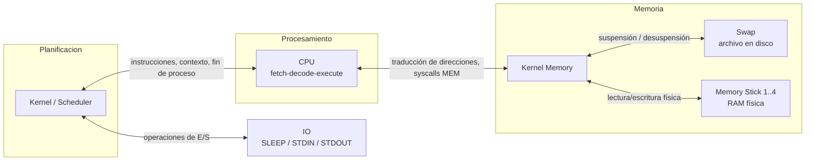

# Sistemas Inoperantes — Simulador de Sistema Operativo distribuido

Trabajo práctico de la cátedra **Sistemas Operativos (UTN FRBA, 1C 2026)**: un
sistema operativo simulado cuyos componentes (CPU, Kernel, Memoria, módulos de
Memoria física y E/S) son **procesos independientes que se comunican por
sockets TCP**, replicando a nivel de software el modelo cliente-servidor de un
SO real: planificación de procesos, gestión de memoria, swap a disco y manejo
de dispositivos de E/S.

Implementado en **C**, usando [so-commons-library] de la cátedra para config,
logging y estructuras de datos, con **pthreads** y sincronización por mutex
para la concurrencia en cada módulo.

## Arquitectura



Cada módulo corre como un proceso aparte (incluso en máquinas distintas) y se
identifica ante los demás con un *handshake* propio. Toda la comunicación usa
un protocolo binario a medida definido en `utils/src/utils/general.h`: un
enum de códigos de operación (`OP_GET_INSTRUCCION`, `OP_READ_MEM`,
`OP_SUSPEND`, `OP_COMPACT_OK`, etc.) seguido de los datos en crudo sobre el
socket, sin libserializar — cada operación envía/recibe sus campos a mano.

## Módulos

| Módulo | Rol |
|---|---|
| **cpu/** | Ciclo *fetch-decode-execute*. Traduce direcciones lógicas a físicas por **segmentación base/límite** (no paginación) y ejecuta el set de instrucciones (`SET`, `SUM`, `SUB`, syscalls de E/S, mutex y memoria). Devuelve `SEG_FAULT` si la dirección excede el segmento. |
| **kernel_scheduler/** | Planificador de procesos: estados `NEW/READY/EXEC/BLOCK/SUSP_READY/SUSP_BLOCK/EXIT`. Algoritmo configurable: **Round Robin** con quantum, o **colas multinivel (CMN)** con una política independiente (FIFO o RR) por cola y desalojo por prioridad cuando llega un proceso de mayor prioridad. Mutex de usuario con **herencia de prioridad**. |
| **kernel_memory/** | Memoria **segmentada**, no paginada: particiones de tamaño variable con asignación **best-fit o worst-fit** configurable, **compactación** de huecos a demanda, y suspensión/desuspensión de procesos a **swap** partiendo sus segmentos en bloques de tamaño fijo. Administra la memoria física distribuida entre varios *memory sticks*. |
| **memory_stick/** | Simula un **módulo de RAM física** independiente: un buffer de bytes de tamaño configurable que se registra ante Kernel Memory y resuelve lecturas/escrituras (`OP_READ_MEM`/`OP_WRITE_MEM`) con latencia artificial. Se pueden levantar varias instancias (hasta 4 en la config provista) para repartir la memoria total entre distintos "sticks". |
| **swap/** | Swap a disco: archivo plano (`archivo_swap.bin`) con bloques de tamaño fijo; atiende `OP_SUSPEND` (escribe un bloque) y `OP_DESUSPEND` (lo recupera) vía `fseek`/`fwrite`/`fread`. |
| **io/** | Simula un dispositivo de E/S genérico en tres modos: `IO_SLEEP` (retardo), `IO_STDIN` (lectura real de entrada estándar) e `IO_STDOUT` (impresión por log), conectado al Kernel. |
| **utils/** | Protocolo de comunicación compartido (enum de operaciones y módulos), *handshake* de identificación y helpers de socket reutilizados por todos los módulos. |

## Puntos destacados

- **Memoria distribuida real entre procesos**: la RAM no es un array dentro de
  Kernel Memory, sino que vive en procesos `memory_stick` separados, cada uno
  con su propio rango `base/tamaño` — Kernel Memory enruta cada acceso al
  stick correspondiente.
- **Protocolo propio sobre TCP**: sin frameworks de RPC ni serialización
  automática; cada operación define a mano su formato de envío/recepción,
  incluyendo manejo de `MSG_WAITALL` para lecturas completas.
- **Planificación configurable en runtime** vía archivo de config: se puede
  pasar de Round Robin a colas multinivel con distinta política por cola sin
  tocar código.
- **Concurrencia con pthreads + mutex** por cada estructura compartida (listas
  de segmentos, colas de ready, CPUs conectadas) y un dispatcher sincronizado
  por semáforo.

## Compilación y ejecución

> [!NOTE]
> Este proyecto está pensado para correr en **Linux** (se desarrolló y probó
> sobre una VM Ubuntu Server de la cátedra). Requiere la biblioteca de la
> cátedra [so-commons-library]:
> ```bash
> git clone https://github.com/sisoputnfrba/so-commons-library
> cd so-commons-library && make debug && make install
> ```

Cada módulo se compila de forma independiente con `make` desde su propia
carpeta; el binario queda en `bin/` dentro de esa carpeta:

```bash
cd kernel_scheduler
make
./bin/kernel_scheduler
```

Para importar todos los módulos como un único workspace de VS Code:

```bash
code tp.code-workspace
```

### Despliegue en una VM

El script [so-deploy] de la cátedra automatiza la instalación de las commons,
el clonado del repo y la compilación de todos los módulos en una máquina
remota:

```bash
git clone https://github.com/sisoputnfrba/so-deploy.git
cd so-deploy
./deploy.sh -r=release -p=utils -p=kernel_scheduler -p=kernel_memory -p=cpu -p=memory_stick -p=swap -p=io "tp-2026-1c-SistemasInoperantes"
```

## Contexto

Repositorio de trabajo práctico grupal para la cátedra de Sistemas Operativos
de la UTN FRBA (1er cuatrimestre 2026). El repositorio original de la cátedra
se eliminó al finalizar el curso; esta es la copia personal con el historial
completo de commits y los tags de checkpoint (`checkpoint-1`, `checkpoint-3`,
`Check_2`).

[so-commons-library]: https://github.com/sisoputnfrba/so-commons-library
[so-deploy]: https://github.com/sisoputnfrba/so-deploy
